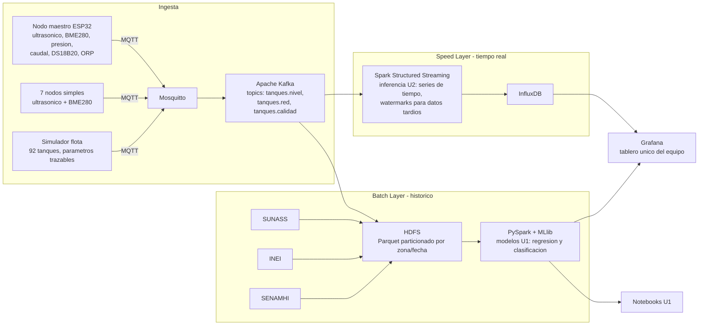

# Arquitectura

## Diagrama general (arquitectura Lambda)



## Nodo maestro

El nodo maestro concentra la instrumentación completa: HC-SR04 (nivel por ultrasonido), BME280 en la cámara de aire (temperatura y humedad), transductor de presión en la línea de entrada, caudalímetro YF-S201, DS18B20 sumergible (temperatura del agua) y sonda ORP.

```mermaid
flowchart LR
  subgraph Sensores
    U[HC-SR04<br/>distancia cm]
    T[BME280<br/>temp y humedad<br/>camara de aire]
    PR[Transductor de presion<br/>linea de entrada]
    C[Caudalimetro YF-S201]
    D[DS18B20 sumergible<br/>temp del agua]
    O[Sonda ORP]
  end
  U --> E[ESP32]
  T --> E
  PR --> E
  C --> E
  D --> E
  O --> E
  E --> CP[Compensacion de velocidad<br/>del sonido en el cabezal<br/>c = 331.3 * sqrt&#40;1 + T/273.15&#41;<br/>corregida por humedad]
  CP --> J[Mensaje JSON<br/>cada 10 s]
  J --> W[WiFi / MQTT<br/>hacia Mosquitto]
```



!!! note "Dato crudo y compensado"
    El nodo publica **ambos** valores: la distancia cruda del ultrasonido (`distancia_cm`) y el nivel ya compensado (`nivel_cm_comp`). La compensación se resuelve dentro del propio cabezal de medición, antes de publicar. Sin ella, la deriva térmica nocturna del altiplano produce una caída aparente de nivel del mismo orden de magnitud que una fuga lenta real.

## Tecnologías por etapa

| Etapa | Tecnología |
|---|---|
| Fuente | Nodos ESP32 (1 maestro + 7 simples) + simulador de flota (92 tanques) |
| Protocolo | MQTT (broker Mosquitto) |
| Ingesta | Apache Kafka — topics `tanques.nivel`, `tanques.red`, `tanques.calidad` |
| Speed layer | Spark Structured Streaming (inferencia U2, watermarks para datos tardíos) → InfluxDB |
| Batch layer | HDFS con Parquet particionado por zona/fecha; PySpark + MLlib (modelos U1) |
| Serving | Grafana (tablero único del equipo) + notebooks Jupyter (U1) |
| Infraestructura | Docker Compose |

## Estado actual del despliegue

Servicios definidos hoy en [pyspark/compose.yml](https://github.com/ClaudioB12/MonitorAqua/blob/main/pyspark/compose.yml) (proyecto `pyspark-oficial`):

| Servicio | Imagen | Puertos (host → contenedor) | Estado |
|---|---|---|---|
| `pyspark` | `jupyter/pyspark-notebook` | 4489 → 8888 (Jupyter), 4041 → 4040 (Spark UI) | **Desplegado** |
| Mosquitto (broker MQTT) | — | — | Previsto |
| Apache Kafka | — | — | Previsto |
| Spark Structured Streaming (speed) | — | — | Previsto |
| InfluxDB | — | — | Previsto |
| HDFS | — | — | Previsto |
| Grafana | — | — | Previsto |

Existe además un [pyspark/Dockerfile](https://github.com/ClaudioB12/MonitorAqua/blob/main/pyspark/Dockerfile) propio (base `python:3.10-slim-trixie` con OpenJDK 21, `pyspark==4.2.0`, `notebook==7.6.2` y `pandas==2.3.3`, Jupyter en el puerto 8888 del contenedor) como imagen alternativa al `jupyter/pyspark-notebook` que usa el compose.

## Esquemas de mensaje

### Nodo maestro (JSON, cada 10 s)

```json
{
  "device_id": "horeb_master_01",
  "timestamp": "2026-09-14T03:15:00",
  "zona": "Zona A",
  "distancia_cm": 45.2,
  "temp_aire_c": -1.8,
  "hum_aire_pct": 97.4,
  "nivel_cm_comp": 55.9,
  "litros": 681,
  "presion_linea_kpa": 0.0,
  "caudal_lpm": 0.0,
  "temp_agua_c": 4.2,
  "orp_mv": 512,
  "bateria_pct": 96
}
```

### Nodo simple

Mismo esquema **sin** `presion_linea_kpa`, `caudal_lpm`, `temp_agua_c` ni `orp_mv`.

### Campos y unidades

| Campo | Unidad | Descripción | Maestro | Simple |
|---|---|---|---|---|
| `device_id` | — | Identificador del nodo | ✔ | ✔ |
| `timestamp` | ISO 8601 | Instante de la lectura | ✔ | ✔ |
| `zona` | — | Zona de Juliaca del tanque | ✔ | ✔ |
| `distancia_cm` | cm | Distancia cruda del ultrasonido | ✔ | ✔ |
| `temp_aire_c` | °C | Temperatura de la cámara de aire (BME280) | ✔ | ✔ |
| `hum_aire_pct` | % | Humedad relativa de la cámara de aire | ✔ | ✔ |
| `nivel_cm_comp` | cm | Nivel compensado por temperatura y humedad | ✔ | ✔ |
| `litros` | L | Volumen almacenado | ✔ | ✔ |
| `presion_linea_kpa` | kPa | Presión en la línea de entrada | ✔ | — |
| `caudal_lpm` | L/min | Caudal de entrada (YF-S201) | ✔ | — |
| `temp_agua_c` | °C | Temperatura del agua (DS18B20) | ✔ | — |
| `orp_mv` | mV | Potencial de óxido-reducción (proxy de cloro residual) | ✔ | — |
| `bateria_pct` | % | Carga de la batería del nodo | ✔ | ✔ |

## Flujo de un dato

Cada 10 segundos, el ESP32 lee sus sensores y calcula el nivel compensado en el propio cabezal; publica el mensaje JSON por WiFi al broker **Mosquitto** vía MQTT. Un puente lleva el mensaje al topic Kafka que corresponde (`tanques.nivel`, `tanques.red` o `tanques.calidad`). Desde Kafka el dato sigue dos caminos a la vez. En la **capa speed**, Spark Structured Streaming lo consume con **procesamiento incremental**: no recalcula nada desde cero, sino que actualiza el estado de cada ventana con la lectura que acaba de llegar (con watermarks para tolerar datos tardíos), aplica la inferencia U2 y escribe el resultado en InfluxDB. En la **capa batch**, el mismo dato se acumula en HDFS como Parquet particionado por zona y fecha, junto con SUNASS, INEI y SENAMHI; allí PySpark lo procesa con **evaluación perezosa**: las transformaciones solo se ejecutan cuando una acción materializa el plan optimizado, al entrenar y evaluar los modelos U1 de MLlib. Ambos caminos convergen en **Grafana**, el tablero único del equipo, donde la serie en vivo y el modelo histórico se leen juntos.
