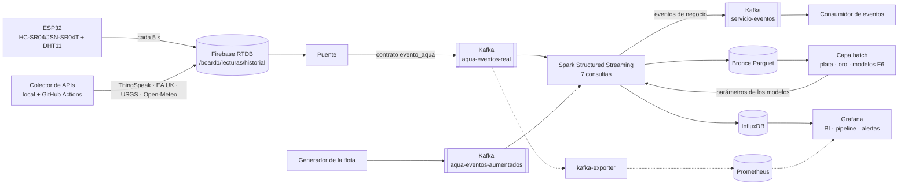

# Producto de la Unidad 2: pipeline en tiempo real

**Producto (plantilla U2 del curso):** pipeline en tiempo real con ingesta de eventos empresariales e IoT/sensores,
procesamiento streaming con Spark, observabilidad y costos, y salidas BI/ML distribuidas.

**En MonitorAqua:**

- **Lecturas:** las del tanque del equipo (ESP32), de 7 canales ThingSpeak y de 3 APIs públicas (EA UK, USGS y
  Open-Meteo).
- **Ruta:** pasan por Kafka y Spark Structured Streaming.
- **Eventos de negocio:** Spark detecta eventos del servicio de agua (llegada, corte, fuga…).
- **Inferencia:** aplica en vivo los modelos de series de tiempo de cada dimensión.
- **Tableros:** Grafana muestra el resultado en un tablero BI y en uno de salud del pipeline.

## Arquitectura desplegada

**Detalle de servicios y puertos:** [Stack y servicios](stack-actual.md). **Diseño original del proyecto:**
[Arquitectura](arquitectura.md).

## Capacidades por sesión

| Sesión | Capacidad | Dónde está |
|---|---|---|
| S6 | Ingesta de eventos empresariales | [Eventos de servicio](eventos-servicio.md): contrato `evento_servicio`, tópico `servicio-eventos`, consumidor en vivo |
| S7 | Ingesta IoT/sensores | [Ingesta unificada](ingesta.md): ESP32 y APIs con contrato `evento_aqua`; [flota extrapolada](datos-aumentados.md) para volumen |
| S8 | Streaming con ventanas, watermark y checkpoint | [Streaming](streaming.md) |
| S9 | Observabilidad y costos | [Tableros y alertas](tableros.md), [costos y escalado](costos-escalado.md) |
| S10 | Series de tiempo e inferencia en streaming | [Dataset](dataset-modelos.md), modelos [D2](modelo-d2.md), [D4](modelo-d4.md), [D6](modelo-d6.md), [D8](modelo-d8.md), [inferencia en vivo](inferencia-en-vivo.md) |
| S11 | BI con KPIs y predicción | [Tableros](tableros.md): tablero "Salud del servicio de agua – Juliaca" con las predicciones de F7 |

## Dimensiones U2 del equipo Horeb

| Dimensión | Integrante | Pregunta en vivo | Modelo |
|---|---|---|---|
| [D2](modelo-d2.md) | Claudio Bustinza Inofuente | ¿Cuántas horas de agua le quedan a este tanque? | perfil de consumo por hora del día (d2.2) |
| [D4](modelo-d4.md) | Wilbert Alex Mayta Arotaype | ¿A qué hora llegará otra vez el agua? | Weibull / Kaplan-Meier sobre los intervalos entre llegadas (d4.1) |
| [D6](modelo-d6.md) | Joel Huillca Lima | ¿Cuánta agua se habrá perdido si la fuga continúa? | tasa nocturna (Theil-Sen) + clasificador de fuga + banda conformal (d6.1) |
| [D8](modelo-d8.md) | Josué Gabriel Ochoa Mamani | ¿A qué temperatura está el agua y cuánto lleva almacenada? | modelo térmico de primer orden con el aire de la cámara y Open-Meteo (d8.1) |

Cada página de modelo sigue el mismo orden:

- pregunta y datos;
- partición sin fuga de información;
- líneas base;
- resultados por conjunto (consistencia en la flota, prueba en ThingSpeak, ESP32 pendiente de su prueba real);
- limitaciones;
- su parte en vivo.

## Rúbrica y evidencia

| Criterio | Evidencia en vivo | Evidencia guardada |
|---|---|---|
| 1. Eventos empresariales con Kafka | `servicio-eventos` en Kafbat (puerto 48085) y log del consumidor | [F4](evidencias/f4/README.md), [f4.4](evidencias/f4/f4.4/README.md) |
| 2. Eventos IoT/sensores | lecturas del ESP32 en el tablero (cada 5 s) y volumen por tópico | [colector en la nube](evidencias/colector-nube/README.md), [F5](evidencias/f5/README.md) |
| 3. Spark: ventanas, watermark, checkpoint | Spark UI (puerto 4043), paneles `spark_progreso` | [F3](evidencias/f3/README.md), [caída sin pérdida](evidencias/f7/caida_sin_perdida.md) |
| 4. Observabilidad | tablero "Salud del pipeline", 6 alertas | [F5](evidencias/f5/README.md), [F7](evidencias/f7/README.md) |
| 5. Costos y escalado | tablero "Prueba de carga (F8)" | [Costos y escalado](costos-escalado.md), [prueba de carga, corridas 1 y 2](evidencias/f8/prueba_carga_corridas_1_y_2.md) |
| 6. Salidas BI | tablero "Salud del servicio de agua – Juliaca" | [F5](evidencias/f5/README.md), [F7](evidencias/f7/README.md) |
| 7. Series de tiempo e inferencia | tablas F7 y fila "Pronóstico vs real" | [D2](evidencias/f6-d2/README.md), [D4](evidencias/f6-d4/README.md), [D6](evidencias/f6-d6/README.md), [D8](evidencias/f6-d8/README.md), [F7](evidencias/f7/README.md) |
| 8. Sustentación | [guion de la demo](guion-demo.md) | — |

**Dónde están las evidencias:** en `docs/evidencias/` del repositorio. Las páginas de evidencia y las capturas se
publican en este sitio; los JSON, CSV y logs de cada carpeta se enlazan desde su README.

**Arranque desde cero:** `README.md` del repositorio.
