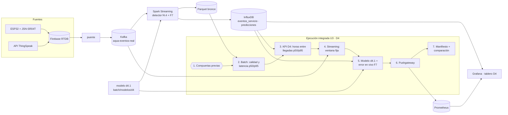

# U3 · D4: ejecución integrada, DataOps y hardening

**Dimensión:** D4 · Próxima llegada del agua · **Responsable:** Wilbert Alex Mayta Arotaype

La Unidad 3 no agrega un modelo nuevo: junta lo que D4 ya tenía por separado en **una sola ejecución que se
comprueba a sí misma**. Antes, cada parte se probaba por su lado: el detector y el Parquet bronce (streaming F3-F4),
el modelo d4.1 (batch F6), la inferencia en vivo (F7) y el tablero (Grafana). Ahora, una sola corrida hace lo
siguiente:

1. **Compuertas previas:** comprueba que sus dependencias existen y responden.
2. **Batch:** procesa el Parquet bronce con Spark, con compuertas de calidad y de plausibilidad.
3. **KPI de tiempo de D4:** calcula las horas entre llegadas con percentiles.
4. **Streaming:** procesa el tópico real en vivo durante una ventana fija.
5. **Modelo d4.1:** lo aplica al estado actual y lee su error en producción.
6. **Observabilidad:** publica el resultado en Prometheus y comprueba que llegó.
7. **Manifiesto:** deja un manifiesto JSON y lo compara con la corrida anterior.

| Archivo | Qué es |
|---|---|
| `u3/d4_ejecucion_integrada.py` | La ejecución integrada (PySpark 4.2.0) |
| `u3/correr_d4.cmd` | El comando para correrla en Windows, con la imagen del job de streaming en la red del stack |
| `u3/levantar_pushgateway.cmd` | Crea el Pushgateway que faltaba (hallazgo 1 del hardening) |
| `u3/artifacts/manifiesto_d4_<runId>.json` | El manifiesto de cada corrida (no se versiona; los elegidos se copian a `docs/evidencias/u3-d4/`) |
| `dashboards/generar_tablero_d4.py` | La fila **"U3 · Ejecución integrada de D4"** del tablero D4 (Prometheus) |

## 1. Flujo completo



## 2. Dependencias

| Componente | Qué necesita | Cómo lo comprueba la ejecución |
|---|---|---|
| Modelo d4.1 | `batch/modelos/d4/d4.1-20261029/modelo.json` (versionado) | Compuerta previa: "Modelo d4.1 existe" |
| Batch | Parquet bronce en `data/local/bronce/` (lo escribe la consulta `bronce` del streaming; no se versiona) | Compuerta previa: "Parquet bronce del ESP32 existe" |
| Streaming | Kafka `kafka:9092`, tópico `aqua-eventos-real`, el puente y el ESP32 publicando | Compuerta previa: "Kafka con datos" y, al final de la ventana, "el stream entregó filas" |
| KPI D4 y modelo | InfluxDB `influxdb:8086` (buckets `monitoraqua` y `monitoraqua_aumentados`; token en `.env`) | Compuerta previa: "InfluxDB listo" |
| Observabilidad | Pushgateway `pushgateway:9091` y Prometheus `prometheus:9090` (lambda26/obs) | Compuertas previas y confirmación final del valor publicado |
| Tablero | Grafana `grafana:3000` (infra/compose.yml) | Compuerta previa: "Grafana saludable" |
| Entorno | Imagen `monitoraqua-streaming` (PySpark 4.2.0, Java 21, conector de Kafka en caché) y red `lambda26-kafka-net` | Si falta, `docker run` no arranca |

## 3. Compuertas

**Compuertas previas.** Corren antes de que Spark lea nada. Si una falla, la ejecución se detiene con el nombre
de la dependencia y deja el manifiesto con `resultado: DETENIDA`. Son siete: modelo d4.1, Parquet bronce, InfluxDB,
Pushgateway, Prometheus, Grafana y Kafka con datos.

**Compuertas de calidad (batch, sobre el bronce de los últimos 7 días de ESP32 y ThingSpeak):**

| Tipo | Compuerta | Por qué |
|---|---|---|
| Existencia | Hay lecturas de tanque en el periodo | Sin lecturas no hay llegadas que detectar |
| Completitud | `eventId`, `sensorId`, `timestamp` e `ingestaTs` sin nulos | Son las columnas que usan la deduplicación y la latencia |
| Rango | Ratio de lecturas válidas en [0, 1]; latencia p50 ≥ 0 | Una latencia negativa indicaría relojes desfasados |
| Plausibilidad (en vivo, sección 4) | **Latencia típica del ESP32 en la ventana de streaming (p50) < 60 s**, con lecturas del ESP32 en la ventana | El ESP32 publica cada 5 s y el puente lee Firebase en vivo: una lectura típica llega en segundos. Se mide en vivo y no sobre el bronce (hallazgo 3) |
| Plausibilidad (KPI D4) | **Horas entre llegadas (p50) entre 6 y 48 h** | El servicio de Juliaca es intermitente pero diario: en U2 el ritmo fue de 23 a 25 h. Fuera de ese rango, el detector o los datos están mal |

**Advertencias (no detienen la ejecución):**
- Más del 20 % de las lecturas del ESP32 en el bronce llegó con más de 1 min de atraso (lecturas recuperadas al encender la PC).
- p95 de la latencia del ESP32 mayor a 5 min (hubo lecturas atrasadas por reconexión).
- p95 del intervalo entre llegadas mayor a 72 h (cortes prolongados o sensor apagado).
- Más del 20 % de los intervalos dura menos de 1 h (llenados partidos o pruebas del sensor).

**Por qué la compuerta usa el p50 y el p95 queda como advertencia:** el p50 describe lo que vive una lectura o una
espera típica. El p95 depende de eventos raros: una reconexión del ESP32 o un corte de agua. Detener el pipeline por
el p95 sería detenerlo por un corte de servicio, que es justo lo que D4 quiere medir, no un error de los datos.

**Prueba de no regresión (sección 5 de la ejecución):** el MAE en vivo de la flota sale del bucket
`monitoraqua_aumentados`, que no cambia. Por eso tiene que dar **siempre 6,223 h**, igual que In [11] del notebook
U2. Si cambia, algo se rompió. Además, cada corrida se compara con la anterior (sección 7).

## 4. Pasos de ejecución (en este orden)

Todo desde la raíz del repo, en **CMD** de Windows.

```bat
:: 1. Stack arriba: Kafka, Prometheus (lambda26) e infra de MonitorAqua. Comprobar:
docker ps --format "table {{.Names}}\t{{.Status}}"

:: 2. Solo la primera vez: crear el Pushgateway (no existía en esta máquina)
u3\levantar_pushgateway.cmd

:: 3. Healthchecks de InfluxDB y Grafana (hardening U3). Recrea solo esos dos, sin tocar Kafka ni los datos
::    (los volúmenes se conservan). El streaming se detiene antes para que no escriba mientras InfluxDB se recrea,
::    y al volver retoma desde su checkpoint.
docker stop lambda26-aqua-streaming
docker compose -f infra/compose.yml --env-file .env up -d --wait influxdb grafana
docker start lambda26-aqua-streaming

:: 4. ESP32 encendido, cerca del router (en el Monitor Serie debe salir "OK pushHistorial")

:: 5. Ejecución integrada (unos 2-3 min; la primera vez, algo más)
u3\correr_d4.cmd

:: 6. Demostrar que una compuerta detiene la ejecución, y volver a dejarlo normal
set FORZAR_FALLA=modelo
u3\correr_d4.cmd
set FORZAR_FALLA=

:: 7. Segunda corrida normal: se compara sola con la anterior
u3\correr_d4.cmd
```

Después, el tablero **"D4 · Llegada del agua (sensor real)"** (http://localhost:43000) muestra en la fila
**"U3 · Ejecución integrada de D4"** los valores que acaban de llegar a Prometheus. En Prometheus
(http://localhost:49090) se ven con la consulta `{job="monitoraqua_d4"}`.

## 5. Qué produce

**En consola:** cada compuerta con OK o FALLA, los percentiles, la predicción de 1233810, el error en vivo, la
confirmación de cada métrica en Prometheus y la tabla de comparación con la corrida anterior.

**Métricas en Prometheus** (job `monitoraqua_d4`, instancia `wilbert`):

| Métrica | Qué es |
|---|---|
| `monitoraqua_d4_batch_lecturas_total` | Lecturas de tanque del batch |
| `monitoraqua_d4_batch_validas_ratio` | Fracción de lecturas válidas |
| `monitoraqua_d4_latencia_ingesta_esp32_p50_s` / `_p95_s` / `_promedio_s` | Latencia de ingesta del ESP32 |
| `monitoraqua_d4_intervalo_llegadas_p50_h` / `_p95_h` | KPI de tiempo de D4 |
| `monitoraqua_d4_stream_filas_total` | Filas que entraron en la ventana de streaming |
| `monitoraqua_d4_mae_vivo_flota_h` / `monitoraqua_d4_dentro_ventana_flota_ratio` | Error del modelo en producción |
| `monitoraqua_d4_ultima_ejecucion_timestamp` | Cuándo corrió (panel de antigüedad) |

**Manifiesto** `u3/artifacts/manifiesto_d4_<runId>.json`: runId, versiones (Spark, Python, modelo), parámetros,
resultado de cada compuerta, volúmenes, percentiles, predicción, error en vivo, métricas confirmadas, advertencias,
duración y resultado (`COMPLETA` o `DETENIDA` con su motivo).

**Qué es reproducible y qué no:** el procedimiento y los datos fijos (modelo, flota, MAE de la flota) se repiten
exactamente. Lo que viene en vivo (filas del stream, latencias, llegadas nuevas, predicción de 1233810) cambia en
cada corrida: no es un defecto, y el manifiesto deja registrado qué dio cada una.

## 6. Comparación de dos corridas

*(Completar con los dos manifiestos reales; la ejecución imprime esta tabla al final.)*

| Comprobación | Corrida 1 | Corrida 2 | ¿Esperable o regresión? |
|---|---|---|---|
| Compuertas previas | | | Regresión si alguna deja de pasar |
| Lecturas del batch | | | Esperable: crece con datos nuevos |
| Latencia ESP32 p50 / p95 | | | Esperable: el p95 depende de las reconexiones |
| Intervalo entre llegadas p50 | | | Esperable: cambia con llegadas nuevas |
| Filas del stream | | | Esperable que varíe; regresión si es 0 |
| MAE en vivo de la flota | 6,223 | 6,223 | Regresión si cambia (datos fijos) |
| Métricas en Prometheus | | | Regresión si dejan de coincidir |
| Duración | | | Esperable: depende de la espera de Prometheus |

## 7. Hardening: revisión de la configuración que usa D4

Lista de comprobación (S14, Tabla 2) aplicada a `infra/compose.yml` y al Pushgateway de lambda26:

| Punto | Resultado antes | Detalle |
|---|---|---|
| Versión de las imágenes | Cumple en parte | `influxdb:2.7.12`, `grafana/grafana:11.4.0` y `grafana-image-renderer:3.11.0` tienen la versión fija. `monitoraqua-ingesta:latest` y `monitoraqua-streaming:latest` son imágenes construidas localmente con el código del repo: riesgo aceptado (sección 8) |
| Reinicio | Cumple | `restart: unless-stopped` en todos los servicios |
| Salud | **Falla** | `grep -c healthcheck infra/compose.yml` daba **0**: ningún servicio declaraba si estaba listo |
| Orden de arranque | **Falla** | `grafana` y `aqua-streaming` declaraban `depends_on: - influxdb`: esperaban a que arrancara, no a que estuviera listo |
| Secretos | Cumple | Usuarios, contraseñas y token se leen de `${...}` del `.env`, que no se versiona |
| Superficie expuesta | Revisar | Se publican 48086 (InfluxDB), 43000 (Grafana), 4043 y 4044 (Spark UI): todos de laboratorio. Ver sección 8 |
| Dependencia de observabilidad | **Falla** | En Prometheus, el target `pushgateway` estaba **DOWN**: el contenedor `lambda26-pushgateway` nunca se creó en esta máquina |

**Fallos corregidos:**

| # | Hallazgo | Corrección | Prueba de la corrección |
|---|---|---|---|
| 1 | El Pushgateway no existía: el target estaba DOWN y nada podía publicar métricas de una ejecución | `u3/levantar_pushgateway.cmd`: el mismo servicio de lambda26/obs (`prom/pushgateway:v1.11.1`, alias `pushgateway`, puerto 49091), con healthcheck | `docker ps` lo muestra `(healthy)`. En Prometheus → Status → Targets, `pushgateway` aparece **UP**. La compuerta previa "Pushgateway listo" da OK |
| 2 | InfluxDB y Grafana sin healthcheck; Grafana esperaba a que InfluxDB arrancara, no a que estuviera listo | `infra/compose.yml`: healthcheck `influx ping` en InfluxDB y `wget /api/health` en Grafana; Grafana con `depends_on: influxdb: condition: service_healthy` | `docker compose ... up -d --wait influxdb grafana` termina con código 0, y `docker ps` muestra `lambda26-influxdb (healthy)` y `lambda26-grafana (healthy)` |

**Antes de escribir el healthcheck, se prueba a mano** (si el comando falla siempre, el servicio quedaría
`unhealthy` para siempre):

```bat
docker exec lambda26-influxdb influx ping
docker exec lambda26-grafana wget -q --spider http://localhost:3000/api/health && echo OK
```

**Prueba de no regresión:** después de las dos correcciones se repite `u3\correr_d4.cmd`. Debe pasar las mismas
compuertas, el MAE de la flota debe seguir en 6,223 h y las métricas deben coincidir en Prometheus (sección 6).

## 8. Riesgos aceptados

| Riesgo | Por qué se acepta aquí | Qué cambiaría en producción |
|---|---|---|
| Imágenes propias con etiqueta `latest` (`monitoraqua-ingesta`, `monitoraqua-streaming`) | Se construyen en la misma máquina desde el código del repo; la versión real es el commit | Etiquetar cada imagen con el commit (`monitoraqua-streaming:<sha>`) y publicarla en un registro |
| Kafka sin volumen | El laboratorio se reconstruye desde cero; el bronce en Parquet guarda la historia | Volumen persistente y más de un broker con replicación |
| Kafka en PLAINTEXT, sin autenticación | Red Docker local `lambda26-kafka-net` | TLS y SASL en cada listener |
| Puertos de InfluxDB, Grafana y Spark UI publicados al host | Se necesita abrir cada herramienta desde el navegador | Publicar solo Grafana detrás de un acceso autenticado |
| El ESP32 depende del WiFi de la casa (hubo huecos de horas) | Es el hardware real del proyecto; la compuerta del stream y el panel "Última lectura" lo detectan | Fuente con respaldo (UPS) y un buffer en la placa que reenvíe al reconectar |
| La geometría del tanque del ESP32 es provisional | Falta medir el tanque; por eso el ESP32 no tiene modelo d4.1 ni caudal confiable | Medir altura útil y capacidad, y reentrenar con sus llegadas |

## 9. Métricas para la demostración (con su origen)

| Métrica | Valor | Origen |
|---|---|---|
| Error del modelo, evaluación (flota) | 1,6 h (Weibull) frente a 2,1 h (bases) | `notebooks/u2/d4_llegadas.ipynb`, In [6]; `docs/modelo-d4.md` |
| Error del modelo en producción (flota) | 6,223 h, 108 verificados | Ejecución integrada, sección 5; Prometheus `monitoraqua_d4_mae_vivo_flota_h` |
| Cobertura de la ventana del 80 % | 77,6 % (flota), 77,1 % (1233810) | Notebook U2, In [9] |
| Horas entre llegadas p50 / p95 | (de la corrida) | Manifiesto `kpiD4`; Prometheus `monitoraqua_d4_intervalo_llegadas_p50_h` |
| Latencia de ingesta del ESP32 p50 / p95 | (de la corrida) | Manifiesto `batch.latenciaIngesta`; Prometheus |
| Filas del stream en la ventana | (de la corrida) | Manifiesto `streaming.filas` |

Cada cifra que se dice en la demo se puede señalar en el manifiesto, en Prometheus o en el notebook.

## 10. Guion de demostración de D4 (5 min)

| Min. | Qué se muestra | Comando o URL | Qué debe verse | Plan alternativo |
|---|---|---|---|---|
| 0-1 | Entorno sano | `docker ps` | Servicios Up; InfluxDB, Grafana y Pushgateway `(healthy)` | Captura con fecha y hora |
| 1-2 | Compuertas previas | `u3\correr_d4.cmd` (sección 1) | Siete OK | Manifiesto de una corrida anterior |
| 2-3 | Batch y su hallazgo | Sección 2-3 de la salida | p50 frente a p95 de la latencia y del intervalo, y las advertencias | Manifiesto guardado |
| 3-4 | Streaming y modelo | Secciones 4-5 | Filas del ESP32 en la ventana, la predicción de 1233810 y el MAE de 6,223 | Captura de la corrida anterior |
| 4-5 | Observabilidad y registro | Prometheus, tablero D4 (fila U3) y `u3/artifacts/manifiesto_d4_*.json` | Métricas confirmadas, antigüedad en verde y el manifiesto abierto | Captura del tablero |

**Antes de la demo:** el ESP32 encendido y publicando (si no, la ventana del stream da 0 filas y la ejecución se
detiene), y el Pushgateway `(healthy)`. Ensayarlo completo con cronómetro.

## 11. Decisiones técnicas y su costo

| Decisión | Por qué | Qué se pierde |
|---|---|---|
| Ejecutar con la imagen del job de streaming (`docker run` + `spark-submit`) y no con un notebook | Misma versión de Spark y del conector que producción; no depende de Jupyter | La salida queda en consola: para la evidencia hay que capturarla |
| Publicar percentiles (p50/p95), no solo el promedio | La latencia y la espera entre llegadas tienen colas largas (reconexiones, cortes): el promedio no describe a la lectura ni a la espera típica | Más métricas y paneles que explicar |
| Compuerta en el p50; el p95 solo advierte | Un corte de agua o una reconexión no es un error de datos: es lo que D4 mide | Un p95 malo no detiene nada: alguien tiene que mirar la advertencia |
| Ventana de streaming acotada (60 s) | Una ejecución integrada tiene que terminar para poder comprobarse y registrarse | Solo se ven unas 12 lecturas del ESP32 por corrida |
| El MAE de la flota como prueba de no regresión | El bucket de la flota no cambia: cualquier cambio en el resultado señala que algo se rompió | No prueba el rendimiento real, solo que el sistema sigue igual |
| Pushgateway para los resultados de la corrida | Es el mecanismo de Prometheus para un trabajo que corre y termina | Un valor viejo parece vivo: por eso está el panel de antigüedad |

## 12. Huecos del sensor: reconstrucción rotulada

El ESP32 no guarda lecturas cuando pierde WiFi o energía. Desde la instalación del JSN-SR04T (29-oct 09:22) hubo
**14 huecos de más de 30 min**. Los más largos: 30-oct 20:51 → 03-nov 17:43 (92,9 h), 03-nov 18:28 → 05-nov 00:36
(30,1 h), 09-nov 04:38 → 11-nov 16:19 (59,7 h) y 11-nov 20:15 → 12-nov 23:21 (27,1 h).

**Lo que NO se hace:** escribir lecturas inventadas en Firebase o en `aqua-eventos-real` como si fueran del sensor. Se
verían como mediciones, contaminarían la evaluación real y contradicen la regla del proyecto (los datos aumentados
nunca van a la ruta real).

**Camino de los datos (no pasa por Firebase):**

```text
Parquet bronce del ESP32 ──> u3/reconstruir_huecos_esp32.py (PySpark) ──> Kafka aqua-eventos-reconstruidos
   (lo real que ya llegó                                                     (tópico propio, 3 particiones)
    por Kafka y Spark)                                                                │
                                                                                      v
              Parquet batch/datos/aumentados/runId=…  <── u3/cargar_reconstruccion_spark.py (PySpark, batch Kafka)
              InfluxDB monitoraqua_aumentados        <──    contrato + dedup por eventId + detector f4.4
```

| Decisión | Detalle |
|---|---|
| Identidad propia | `sensorId = esp32-tanque-real-01-reconstruido`, `origen = reconstruccion-esp32`, `fuenteTipo = aumentado`, `runId = reconstruccion-esp32-<fecha>`, `reconstruido = true` |
| Contrato | `contratos/evento_reconstruido.schema.json` (propio; no cambia el contrato común `evento_aqua`) |
| Tópico propio | `aqua-eventos-reconstruidos`: ni el real ni el de la flota, así la inferencia en vivo de F7 no lo procesa |
| Entrega | Al-menos-una-vez; `eventId = sensorId-timestamp` es determinístico y Spark deduplica: re-publicar no duplica |
| Destino | Solo datos aumentados: Parquet `batch/datos/aumentados/runId=…/fecha=…` (no versionado) y el bucket `monitoraqua_aumentados` |
| Método | **Días análogos**: el nivel avanza con los cambios minuto a minuto de un día real completo del mismo ESP32 (30-oct, 6, 7 y 8-nov), a la misma hora del día; parte de la última lectura real antes del hueco y se corrige linealmente para terminar en la primera después. Aire y humedad copian el ciclo diario del día donante. Ruido de 5 s: residuos reales del sensor (≤ 3 cm) |
| Reproducible | Semilla fija (2026): dos corridas dan lo mismo |
| En Grafana | Tablero D4: **línea gris punteada** "reconstrucción, no medido" y **franja gris** "Sensor sin conexión" sobre cada hueco |
| Uso | Ver la serie continua y probar el detector sobre ella. **No entra en la métrica de ningún modelo** ni en la evaluación real |
| Evidencia | `docs/evidencias/u3-d4/reconstruccion_huecos_esp32.json`: huecos, días donantes, mensajes en Kafka, duplicados, Parquet y puntos de InfluxDB |

**Cómo correrlo** (CMD, raíz del repo): `u3\reconstruir_huecos.cmd` hace los tres pasos (crear el tópico si no
existe, publicar en Kafka y cargar con Spark). Por separado:

```bat
docker exec lambda26-kafka /opt/kafka/bin/kafka-topics.sh --bootstrap-server kafka:9092 --create --if-not-exists ^
  --topic aqua-eventos-reconstruidos --partitions 3 --replication-factor 1
docker run --rm --network lambda26-kafka-net --env-file .env -v "%cd%:/repo" -w /repo monitoraqua-streaming:latest ^
  spark-submit --packages org.apache.spark:spark-sql-kafka-0-10_2.13:4.2.0 --driver-memory 2g ^
  --conf spark.log.level=ERROR u3/reconstruir_huecos_esp32.py
docker run --rm --network lambda26-kafka-net --env-file .env -e INFLUX_URL_INTERNA=http://influxdb:8086 ^
  -v "%cd%:/repo" -w /repo monitoraqua-streaming:latest ^
  spark-submit --packages org.apache.spark:spark-sql-kafka-0-10_2.13:4.2.0 --driver-memory 2g ^
  --conf spark.log.level=ERROR u3/cargar_reconstruccion_spark.py
```

**Cómo sustentarlo:** "El sensor perdió conexión varios días: la franja gris lo muestra. La línea punteada es una
reconstrucción con el comportamiento real del mismo tanque. Viaja por su propio tópico de Kafka y la carga Spark con
contrato y deduplicación, igual que lo real, pero rotulada y separada de lo medido; los modelos se evalúan solo con
lecturas reales. La mejora definitiva es un buffer en la placa que reenvíe al reconectar."

## 13. Bitácora de hallazgos

| # | Hallazgo | Causa | Corrección | Prueba |
|---|---|---|---|---|
| 1 | Target `pushgateway` DOWN en Prometheus | El contenedor nunca se creó en esta máquina | `u3/levantar_pushgateway.cmd` | Target UP y compuerta OK |
| 2 | Ningún servicio de `infra/compose.yml` declaraba si estaba listo | Configuración mínima de U2 | Healthchecks y `service_healthy` | `up -d --wait` con código 0 y `(healthy)` |
| 3 | La primera corrida (`20261111T210136Z`) se **detuvo** en la compuerta "latencia típica del ESP32 (p50) < 60 s": p50 = 253 763 s (~70 h), promedio 184 543 s (~2,1 días), p95 380 051 s, y el 62,6 % de las 45 237 lecturas con más de 1 min | El bronce mezcla dos grupos: lecturas en vivo (segundos) y lecturas que el puente **recupera de Firebase al encender la PC** tras días apagada (el ESP32 siguió escribiendo en la nube). Su "latencia" es el tiempo que la PC estuvo apagada, no la del pipeline. El promedio no describe a ninguno de los dos grupos, y aquí ni el p50 servía | La compuerta de plausibilidad pasó a la **ventana en vivo** (p50 de las lecturas del ESP32 en el stream < 60 s). Sobre el bronce, la latencia queda como KPI con p50/p95 y una advertencia si más del 20 % llegó con más de 1 min | La corrida siguiente imprime la latencia del bronce con su advertencia y la compuerta en vivo con OK; el manifiesto `DETENIDA` de la primera corrida queda como evidencia |
| 4 | El ESP32 no tenía lecturas en el bronce después del 09/11 | Sensor apagado o sin WiFi | Compuerta en la ventana en vivo: "lecturas del ESP32 en la ventana" | Si el ESP32 está apagado, la ejecución se detiene con ese nombre |
| 5 | 14 huecos de más de 30 min en el ESP32 (el mayor, 92,9 h) | El sensor no guarda lecturas sin WiFi o sin energía | Franja "Sensor sin conexión" en el tablero y reconstrucción rotulada en datos aumentados (sección 12) | `docs/evidencias/u3-d4/reconstruccion_huecos_esp32.json` y tablero D4 |
